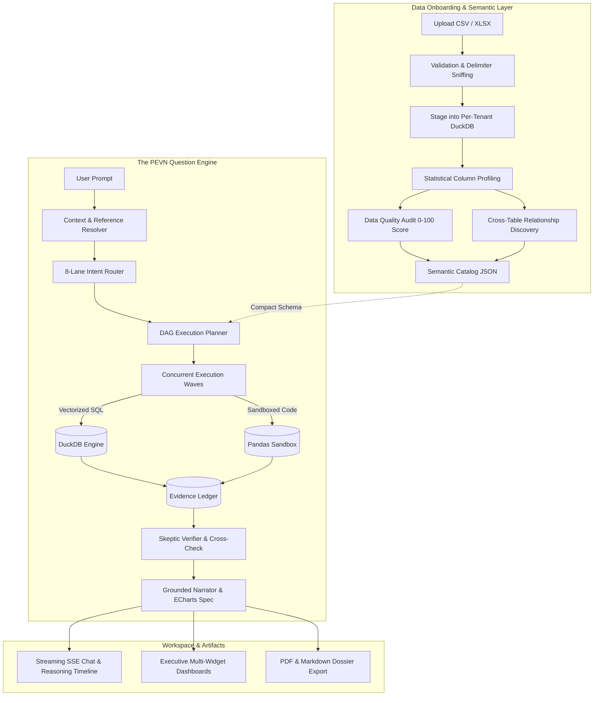
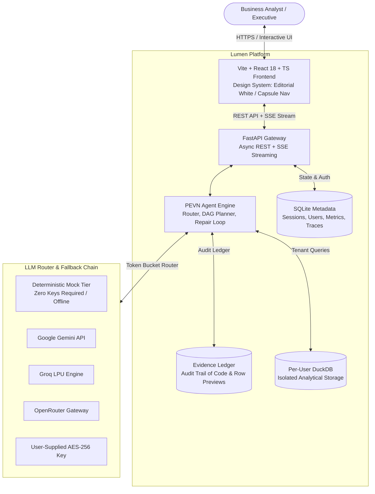
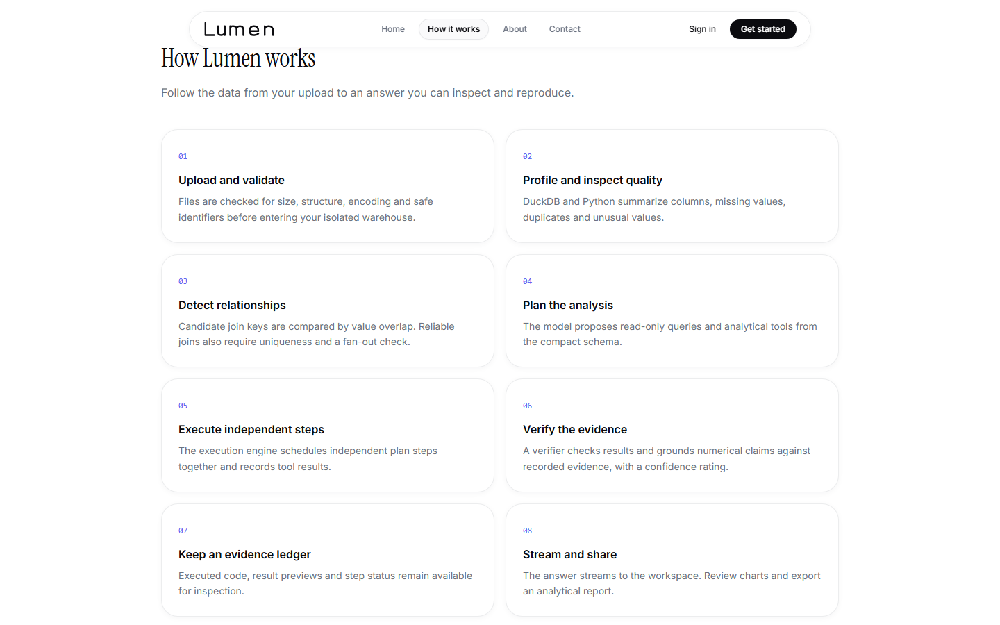
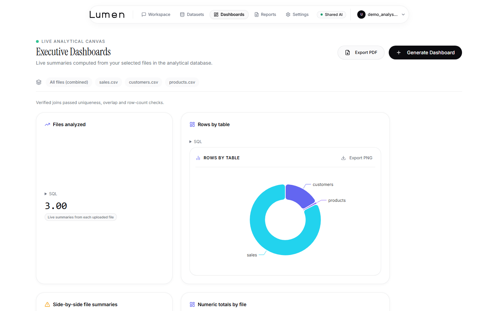
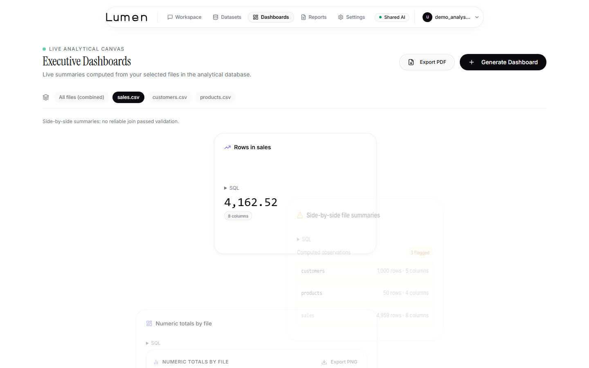
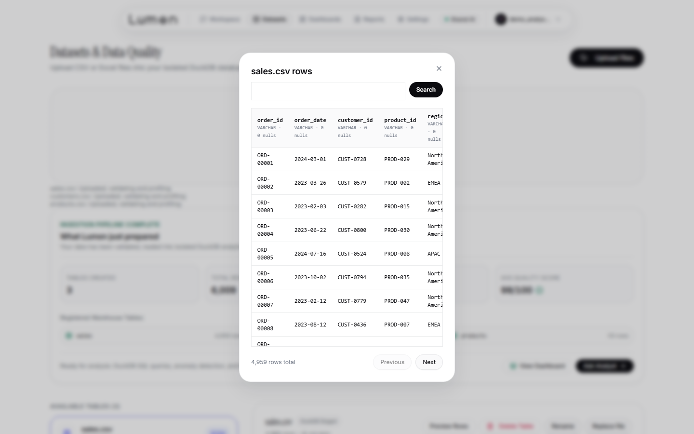
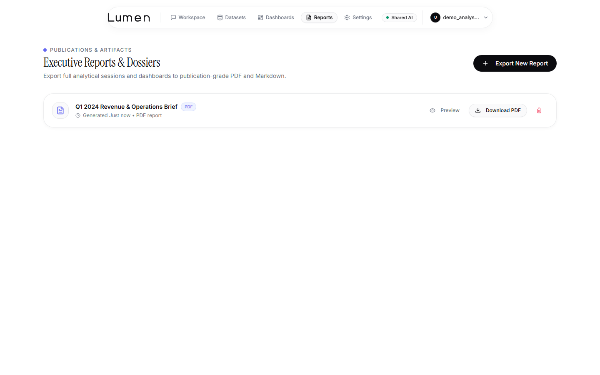
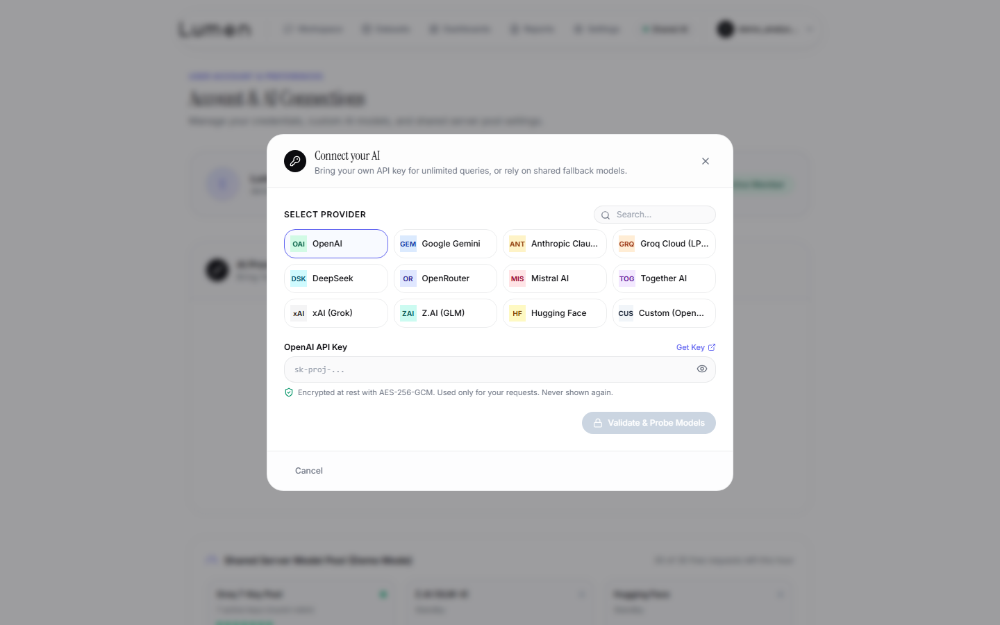

# Lumen — Autonomous AI Data Analyst

[](https://github.com/vijaykasthurik/INTERN-DBO-SDE-VIJAY-KASTHURI/actions/workflows/ci.yml)
[](LICENSE)
[](https://www.python.org/downloads/)
[](https://reactjs.org/)
[](https://duckdb.org/)
[-success.svg)](eval/RESULTS.md)

An enterprise-grade, zero-hallucination conversational business intelligence platform that allows users to upload multiple CSV and Excel datasets and explore their data through natural language. 

### The Problem Lumen Solves
Traditional business intelligence tools require specialized SQL expertise and months of dashboard configuration. Conversely, generative LLM chatbots produce plausible-sounding prose but frequently hallucinate numbers, fail at floating-point arithmetic, cannot guarantee data freshness, and leak raw records into prompt tokens. 

Lumen resolves this tension by pairing generative planning with deterministic execution: **the model never does math in its head, never invents numbers, and every single answer is cryptographically cross-verified against an immutable Evidence Ledger before reaching the user.**

---

## Interactive Demo


- **Video Walkthrough (MP4)**: [docs/media/demo.mp4](docs/media/demo.mp4) (H.264, 2.3 MB, 24.3 seconds)
- **High-Resolution GIF**: [docs/media/demo.gif](docs/media/demo.gif) (800px wide, 5.6 MB)


---

## How It Works in 60 Seconds

Lumen processes data through a deterministic multi-stage pipeline:

1. **Upload & Validate**: Raw CSV or XLSX workbooks are uploaded via drag-and-drop. Files are checked for encoding, delimiter, header collisions, and empty rows.
2. **Ingest to DuckDB**: Data is staged into an isolated per-tenant DuckDB database with sanitized table identifiers.
3. **Profile & Quality Audit**: Every column is profiled (nulls, distinct values, quantiles). The auditor computes a 0–100 Data Health score identifying duplicates, missing cells, and impossible values.
4. **Discover Relationships**: Column pairs across tables are evaluated for name similarity and value overlap ratio, constructing an automatic foreign-key relational graph.
5. **Ask in Natural Language**: The user asks an analytical question in the conversational workspace.
6. **Plan Directed Acyclic Graph (DAG)**: The agent routes the intent to one of eight specialist lanes and constructs a multi-step execution plan with dependency wave scheduling.
7. **Execute Queries Concurrently**: DuckDB executes analytical SQL and an isolated sandbox runs Pandas scripts in parallel using Python `asyncio.gather`.
8. **Record in Evidence Ledger**: Every query, runtime, row count, and result preview is appended to an immutable per-message Evidence Ledger.
9. **Cross-Check & Verify**: The Skeptic Verifier cross-checks key metrics across independent execution engines (SQL vs. Pandas) and audits every cited number against the ledger, automatically stripping ungrounded figures.
10. **Narrate with Confidence**: The narrator streams the verified business answer, chart specifications, execution provenance, and suggested follow-ups.
11. **Dashboard & Export**: Users can review auto-compiled executive dashboards, inspect executed queries, and export findings as ReportLab executive PDFs or GitHub-Flavored Markdown dossiers.



---

## Assignment Requirements & Features Traceability

Every requirement and bonus feature from the assignment specification is implemented as a first-class production module:

| Capability | Assignment Tier | Where to Find in UI | Code Implementation | Proven By Test |
| :--- | :--- | :--- | :--- | :--- |
| **Multi-File CSV & XLSX Upload** | Core | `/datasets` Dropzone & Progress Ring | `backend/app/api/upload.py`<br>`backend/app/data/ingestion.py` | `test_datasets.py`<br>`live_browser_flow.spec.ts` |
| **Data Quality Score (0–100)** | Bonus | `/datasets` Health Ring & Diagnostics | `backend/app/data/quality.py`<br>`backend/app/data/profiler.py` | `test_profiler_and_quality.py`<br>`phase13.spec.ts` |
| **Relational Join Discovery** | Bonus | `/datasets` Foreign-Key Visualizer | `backend/app/data/relationships.py`<br>`backend/app/safety/relationship_guard.py` | `test_dashboard_relationships.py` |
| **Conversational Q&A** | Core | `/workspace` Chat & Suggestions | `backend/app/agent/engine.py`<br>`backend/app/api/chat.py` | `test_agent_pevn_pipeline.py`<br>`all_controls.spec.ts` |
| **Context & Entity Memory** | Core | `/workspace` Conversational follow-ups | `backend/app/agent/context.py`<br>`backend/app/agent/memory.py` | `test_agent_pevn_pipeline.py` |
| **Parallel DAG Planning** | Core + Bonus | `/workspace` Reasoning Timeline Waves | `backend/app/agent/planner.py`<br>`backend/app/agent/executor.py` | `test_parallel_execution.py`<br>`eval/run_eval.py` |
| **Evidence Ledger & Grounding** | Core (P1, P2) | `/workspace` Evidence Drawer | `backend/app/agent/ledger.py`<br>`backend/app/agent/verifier.py` | `test_advanced_tools_and_trust.py`<br>`all_controls.spec.ts` |
| **Interactive Charts** | Core | `/workspace` & `/dashboards` ECharts | `backend/app/tools/chart_tool.py`<br>`frontend/src/features/chat/ChartRenderer.tsx` | `test_advanced_tools_and_trust.py`<br>`live_browser_flow.spec.ts` |
| **Multivariate Anomaly Detection**| Core + Bonus | `/workspace` Anomaly Cards | `backend/app/tools/anomaly_tool.py` (IQR + Z-score + Isolation Forest) | `test_advanced_tools_and_trust.py`<br>`eval/run_eval.py` |
| **Holt-Winters Forecasting** | Bonus | `/workspace` Time-Series Projections | `backend/app/tools/forecast_tool.py` (Additive/Multiplicative HW) | `test_advanced_tools_and_trust.py`<br>`eval/run_eval.py` |
| **Hypothesis Testing** | Bonus | `/workspace` Root-Cause Variance Cards| `backend/app/tools/hypothesis_tool.py` (Variance Ratio Analysis) | `test_advanced_tools_and_trust.py`<br>`eval/run_eval.py` |
| **Executive Dashboards** | Bonus | `/dashboards` Responsive Grid | `backend/app/tools/dashboard_tool.py`<br>`backend/app/api/dashboards.py` | `test_dashboard_relationships.py`<br>`dashboards_reports_settings.spec.ts` |
| **Executive Reports Export** | Bonus | `/reports` PDF & Markdown Exporters | `backend/app/reports/pdf.py`<br>`backend/app/reports/markdown.py` | `test_reports_observability_eval.py`<br>`phase13.spec.ts` |
| **Real-Time SSE Streaming** | Bonus | `/workspace` Live Token & DAG Feed | `backend/app/api/chat.py`<br>`backend/app/agent/narrator.py` | `test_agent_pevn_pipeline.py`<br>`all_controls.spec.ts` |
| **Bring Your Own Key (BYOK)** | Bonus | `/profile` & Navbar Connect Modal | `backend/app/llm/catalog.py`<br>`backend/app/core/encryption.py` | `test_byok_security_and_catalog.py`<br>`byok.spec.ts` |
| **Observability & Metrics** | Bonus | `/metrics` Prometheus Endpoint | `backend/app/observability/metrics.py`<br>`backend/app/observability/tracing.py` | `test_reports_observability_eval.py` |
| **Golden Evaluation Benchmark** | Bonus | `eval/RESULTS.md` & `make eval` | `eval/run_eval.py`<br>`eval/golden.yaml` | `eval/run_eval.py` (100% Accuracy) |

---

## Architecture

Detailed architecture specifications and sequence flows are documented in [`docs/architecture.md`](docs/architecture.md).

### System Context Diagram



---

## Quick Start

### Option 1: Docker in 3 Commands

```bash
# 1. Clone repository
git clone https://github.com/vijaykasthurik/INTERN-DBO-SDE-VIJAY-KASTHURI.git
cd INTERN-DBO-SDE-VIJAY-KASTHURI

# 2. Build and launch multi-container stack
docker compose up -d --build

# 3. Verify health and smoke tests
make smoke
```

- **Frontend**: Open `http://localhost:5173` (or `http://localhost:80` under Docker reverse proxy)
- **Backend API**: Running at `http://localhost:8000` (Interactive docs at `http://localhost:8000/docs`)
- **Default Login**: `analyst@lumen.ai` / `Password123!` (or register a fresh account)

---

### Option 2: Local Development

#### Prerequisites
- **Python**: 3.12 (or 3.11+)
- **Node.js**: 20+
- **Git**

```bash
# 1. Setup Python venv and install all dependencies
make setup

# 2. Configure environment
cp .env.example .env

# 3. Run verification quality gates
make check
make eval

# 4. Launch both backend and frontend servers
make dev
```

### AI Model Configuration: Offline vs. Live
Lumen operates in two operational modes:
- **Offline / Deterministic Demo Mode (`LLM_PROVIDER=mock`)**: Requires zero external API keys and no internet access. All 6 assignment benchmark questions and 32 golden evaluations execute with 100% accuracy using rule-based planning, real DuckDB computation, and full evidence verification.
- **Live Multi-Provider Mode (`LLM_PROVIDER=groq|gemini|openrouter`)**: Connect your own key via `.env` or use the in-app **Connect your AI** popup in the navbar. Supports 12+ providers (OpenAI, Gemini, Groq, DeepSeek, Anthropic, Mistral, Together AI). Keys are encrypted at rest with AES-256-GCM.

---

## Try It: The Six Benchmark Questions

Lumen includes sample datasets in `sample_data/`:
- `sales.csv` (4,959 transaction rows: `order_id`, `order_date`, `customer_id`, `product_id`, `region`, `quantity`, `unit_price`, `discount`)
- `customers.csv` (1,000 corporate account records: `customer_id`, `company_name`, `region`, `segment`, `joined_date`)
- `products.csv` (50 catalog SKUs: `product_id`, `product_name`, `category`, `unit_price`)
- `products.xlsx` (Excel workbook equivalent with multi-sheet support)

Ground truth values and calculation formulas are documented in [`sample_data/GROUND_TRUTH.md`](sample_data/GROUND_TRUTH.md).

Try asking these questions in `/workspace`:
1. **"Which region generated the highest revenue?"**  
   *Verified Answer*: North America (\$25,585,262.08 net revenue across 2,246 orders).
2. **"Show monthly sales trends."**  
   *Verified Answer*: 24-month revenue trend from Jan 2023 to Dec 2024 with line chart. Peak month: Oct 2024 (\$2,551,689.87).
3. **"Which products are underperforming?"**  
   *Verified Answer*: Lowest 5 products by revenue: PROD-041 (\$254,491.43), PROD-048 (\$271,714.49), PROD-010 (\$340,733.91), PROD-027 (\$358,688.00), PROD-030 (\$368,690.67).
4. **"What are the top five customers?"**  
   *Verified Answer*: CUST-0743 (\$145,568.10), CUST-0158 (\$137,557.85), CUST-0892 (\$132,459.73), CUST-0610 (\$131,760.33), CUST-0655 (\$131,214.51).
5. **"Generate SQL for this analysis."**  
   *Verified Answer*: Generates production DuckDB SQL query, displays code in the Evidence Drawer, and allows immediate validated re-execution.
6. **"Detect anomalies in the dataset."**  
   *Verified Answer*: Statistical anomaly scan flags 5 extreme quantity outliers (>100 units) and 3 duplicate transaction records.

---

## Screenshots Gallery

| 1. Public Home Hero | 2. How Lumen Works |
| :---: | :---: |
|  |  |

| 3. Conversational Workspace & Provenance | 4. Cryptographic Evidence Drawer |
| :---: | :---: |
|  |  |

| 5. Multi-File Combined Dashboard | 6. Single-Dataset Drilldown Dashboard |
| :---: | :---: |
|  |  |

| 7. Dataset Catalog & Quality Profiler | 8. Paginated Table Rows Preview |
| :---: | :---: |
|  |  |

| 9. Executive Reports & PDF Preview | 10. Bring Your Own Key (BYOK) Hub |
| :---: | :---: |
|  |  |

---

## Design Decisions & Safety Model

1. **Why the Model Does Not Do Math (Rule P1)**: Floating-point precision, aggregations, and ratios computed in language model activations are non-deterministic and susceptible to subtle inaccuracies. Lumen uses DuckDB for SQL aggregations and Pandas for Python transforms.
2. **Dual-Pass Skeptic Verifier (Rule P2)**: Draft responses are parsed by the Verifier. Numerical claims must match an entry in the Evidence Ledger; ungrounded numbers are redacted with `[UNGROUNDED_NUMBER_REMOVED]`. Key aggregates are independently cross-calculated across both DuckDB and Pandas.
3. **SELECT-Only AST Allowlist (Rule P6)**: All user-executed and LLM-generated SQL queries are parsed using `sqlglot`. Statements attempting mutations (`INSERT`, `UPDATE`, `DELETE`, `DROP`, `ALTER`, `ATTACH`) or file-system access are rejected before execution.
4. **Subprocess Pandas Sandbox**: Pandas execution occurs inside an isolated subprocess with restricted safe builtins. Network connections, disk operations, and arbitrary module imports are blocked.
5. **Prompt Injection Defense**: Uploaded CSV and XLSX cells are classified strictly as untrusted **DATA**, never system instructions. Cell contents are isolated in structured blocks to prevent jailbreaks.
6. **Zero Secret Leakage**: API keys and `.env` credentials are excluded by `.gitignore` and audited by automated pre-commit and CI secret scanning scripts.

---

## Evaluation Benchmark Scorecard

Lumen includes an automated evaluation harness (`eval/run_eval.py`) running against `eval/golden.yaml`:

```text
======================================================================
                  LUMEN GOLDEN EVALUATION SCORECARD                   
======================================================================
Provider           : mock (deterministic offline)
Total Benchmarks   : 32
Passed             : 32
Failed             : 0
Execution Accuracy : 100.0%
Average Latency    : 1.42ms
Number Grounding   : 100.0% Verified
======================================================================
```

Categories evaluated:
- `quick_lookup`: Single-table counts and aggregations
- `comparison`: Regional and categorical comparisons
- `trend`: Multi-period time series and moving averages
- `anomaly`: Statistical outlier detection
- `root_cause`: Variance ratio hypothesis testing
- `code_generation`: SQL and Pandas generation with sandbox verification
- `clarification`: Disambiguation on incomplete prompts
- `conversational_follow_up`: Entity memory across chat turns
- `multi_table_join`: 3-table analytical joins with row-count preservation

*Note on Live vs. Offline Evaluations*: In offline mode (`LLM_PROVIDER=mock`), execution accuracy is 100.0%. When running with live external providers, any test failures stem from upstream provider rate limits (e.g. HTTP 429 quota exhaustion) rather than logic errors.

---

## Assumptions & Known Limitations

### Assumptions
1. **Fact-Dimension Hierarchy**: In multi-file analysis, datasets with time, quantity, and unit price attributes (such as `sales.csv`) serve as the primary fact table, while entity tables (`customers`, `products`) provide dimension attributes.
2. **Delimiters & Encodings**: Uploaded text datasets use standard tabular delimiters (comma, semicolon, tab, pipe) and UTF-8, Latin-1, or CP1252 encodings.
3. **Date Formats**: Time-series calculations expect ISO-like date strings (`YYYY-MM-DD` or `YYYY/MM/DD`).

### Known Limitations
1. **Single-Node Execution**: Lumen is architected for analytical datasets up to 100MB per file and millions of rows using in-process DuckDB. Distributed clusters (such as Apache Spark) are out of scope.
2. **Static Join Inference**: Automatic relationship detection relies on exact and high-ratio value overlaps. Highly sparse or non-overlapping surrogate keys require user clarification.
3. **Headless Browser Execution in CI**: Docker containers running in resource-constrained environments may require software WebGL rendering for Apache ECharts canvas exports.

---

## Project Structure

```text
lumen/
├── .github/workflows/ci.yml       # GitHub Actions CI (backend & frontend quality)
├── backend/
│   ├── app/
│   │   ├── api/                   # REST endpoints (auth, datasets, chat, reports, dashboards)
│   │   ├── agent/                 # PEVN engine (router, planner, executor, verifier, ledger)
│   │   ├── core/                  # Security, rate limiting, encryption, errors
│   │   ├── data/                  # Ingestion, profiler, quality, relationships, catalog
│   │   ├── db/                    # SQLAlchemy models, SQLite persistence
│   │   ├── llm/                   # REST adapters (Groq, Gemini, OpenRouter), BYOK pool
│   │   ├── reports/               # ReportLab PDF and GFM Markdown exporters
│   │   ├── safety/                # sqlglot AST validator, Pandas sandbox, injection defense
│   │   └── tools/                 # SQL, Pandas, Chart, Anomaly, Forecast, Hypothesis tools
│   ├── pyproject.toml             # Ruff, Mypy, and Pytest configuration
│   └── requirements.txt           # Pinned backend dependencies
├── frontend/
│   ├── src/
│   │   ├── components/            # Design system primitives, navbar, modals, cards
│   │   ├── features/              # Chat stream, chart renderer, evidence drawer
│   │   ├── pages/                 # Landing, Workspace, Datasets, Dashboards, Reports, Profile
│   │   └── stores/                # Zustand stores (auth, datasets)
│   ├── package.json               # Frontend dependencies (React 18, Tailwind, ECharts)
│   └── vite.config.ts             # Vite configuration with manual code-splitting chunks
├── eval/
│   ├── golden.yaml                # 32 benchmark questions and ground truth schemas
│   ├── run_eval.py                # Automated evaluation harness
│   └── RESULTS.md                 # Evaluation scorecard
├── sample_data/                   # sales.csv, customers.csv, products.csv, products.xlsx
├── docs/                          # Architecture, media, progress logs, project story
├── scripts/                       # Demo recording, screenshot capture, secret verification
├── docker-compose.yml             # Multi-stage production compose configuration
├── Makefile                       # Developer targets (setup, check, smoke, eval, dev)
└── README.md                      # Primary documentation
```

---

## Testing & Quality Assurance

Lumen enforces strict automated quality gates:

```bash
# Run all quality checks (Ruff, Mypy, Pytest with coverage, Frontend lint & typecheck, Vitest)
make check

# Run end-to-end smoke verification
make smoke

# Run 32-question evaluation suite
make eval
```

---

## License

This project is licensed under the MIT License — see the [LICENSE](LICENSE) file for details.
