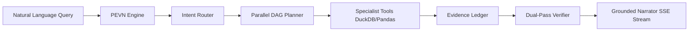

# Lumen — The Autonomous AI Data Analyst

> Enterprise-grade, verified conversational business intelligence platform powered by DuckDB, evidence-grounded planning, and dual-pass cross-verification.

[](https://github.com/vijaykasthurik/INTERN-DBO-SDE-VIJAY-KASTHURI/actions/workflows/ci.yml)
[](LICENSE)
[](https://www.python.org/downloads/)
[](https://reactjs.org/)

---

## 🌟 Overview
**Lumen** transforms how business leaders and data teams interact with multi-table datasets. Unlike standard conversational LLM wrappers that hallucinate metrics or perform inaccurate floating-point arithmetic, Lumen operates under an ironclad principle: **The LLM NEVER computes numbers.**

All calculations are executed natively by **DuckDB** and sandboxed **Pandas**. Every metric cited in answers is cryptographically reconciled against the **Evidence Ledger** and audited by a dual-pass **Verifier** before the user sees it.

---

## 🚀 Key Architectural Pillars



1. **PEVN Pipeline**: Plan, Execute, Verify, Narrate with live SSE stream telemetry.
2. **Evidence Ledger**: Immutable audit trail storing `{step_id, tool, code, result_preview, runtime_ms, row_count}`.
3. **Dual-Pass Verifier**: Cross-checks SQL query results against independent sandboxed Pandas code and verifies number grounding.
4. **Deterministic Mock Provider**: Fully testable and demoable offline without API keys (`LLM_PROVIDER=mock`).
5. **Multi-Table Relational Graphs**: Automatic foreign key detection with value-overlap scoring and compact semantic catalog.

---

## 🛠️ Quick Start

### Prerequisites
- Python 3.11+
- Node.js 20+
- Git

### Installation & Quality Gate
```bash
# 1. Setup dependencies
make setup

# 2. Run all quality checks (Ruff + Mypy + Pytest + ESLint + Vitest + Build)
make check

# 3. Start development stack
# Backend:
make dev-backend
# Frontend:
make dev-frontend
```

---

## 📊 Sample Datasets & Ground Truth
Lumen includes deterministic sample datasets in `sample_data/` generated with seed `42`:
- `sales.csv`: ~5,000 orders spanning 24 months across 4 global regions.
- `customers.csv`: 1,000 customer accounts with segment metadata.
- `products.csv`: 50 products across four enterprise categories.
- `GROUND_TRUTH.md`: Documented ground truth benchmarks for evaluation.
