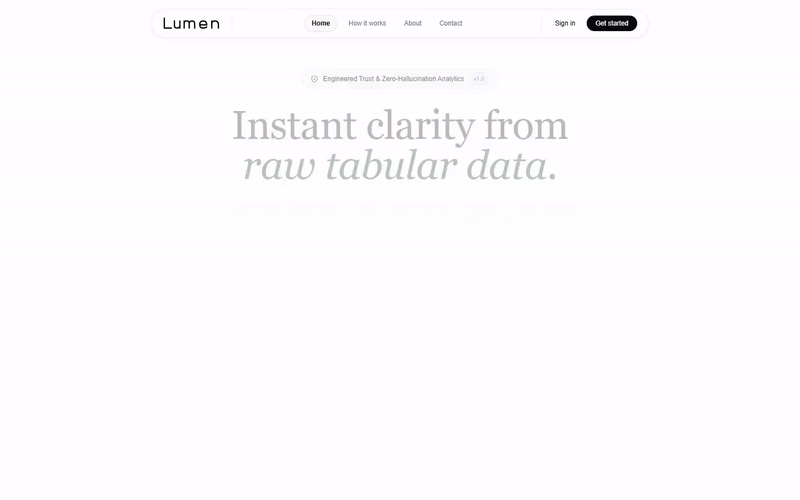
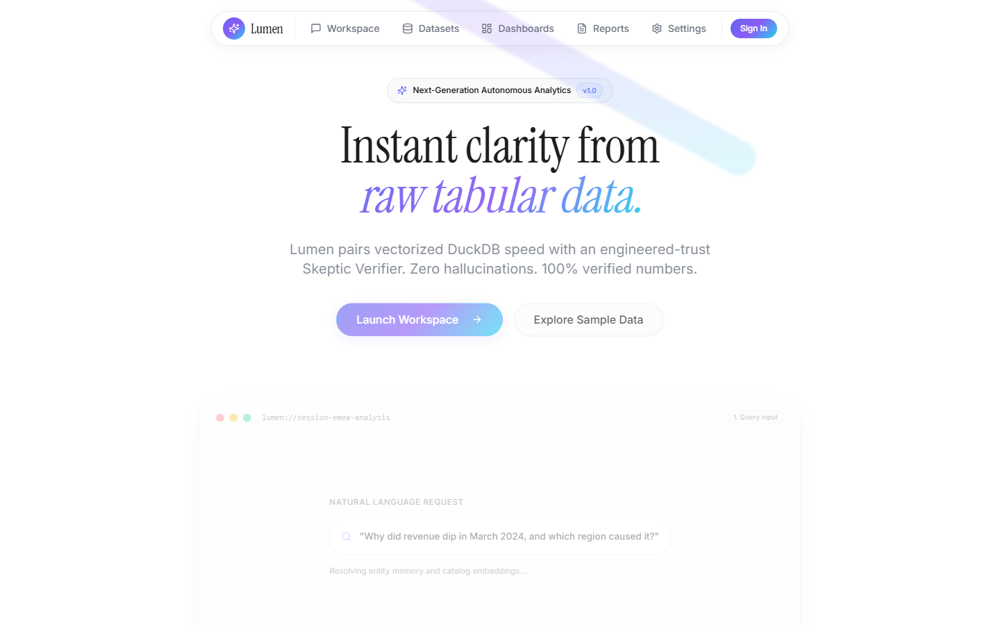
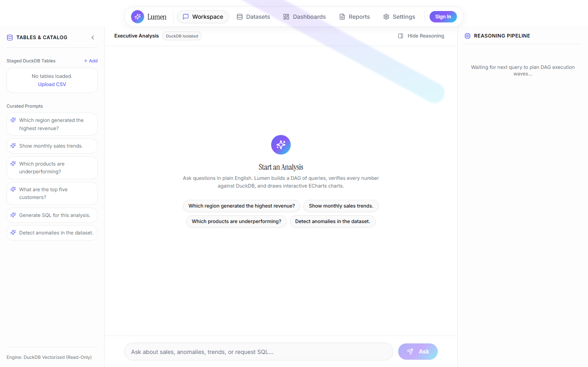
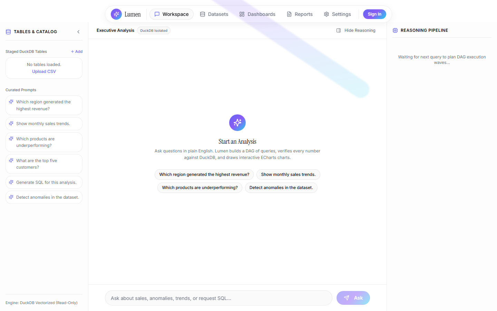
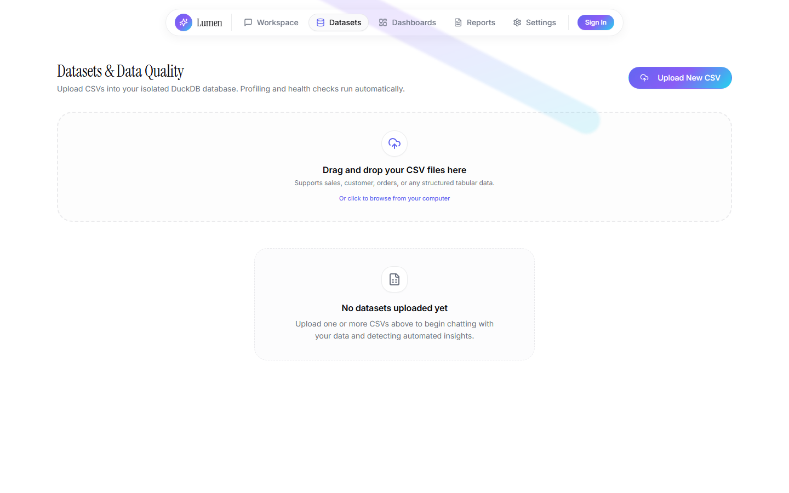
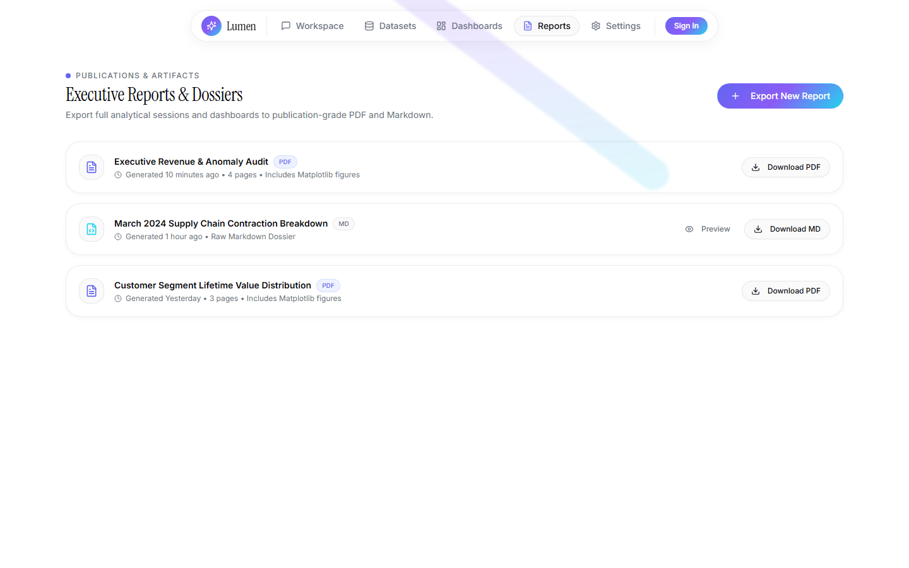
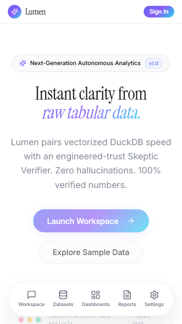
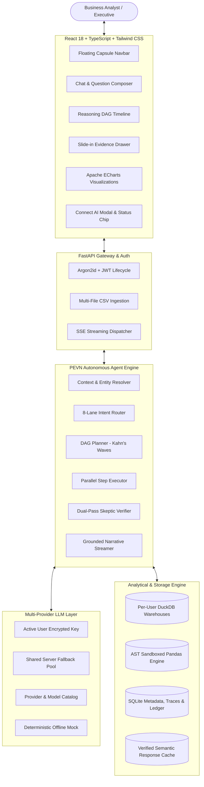

# Lumen — The Autonomous AI Data Analyst

> **Enterprise-grade, zero-hallucination conversational business intelligence platform powered by DuckDB, evidence-grounded parallel DAG execution, dual-pass cross-verification, and Bring-Your-Own-Key (BYOK) multi-provider AI resilience.**

[](https://github.com/vijaykasthurik/INTERN-DBO-SDE-VIJAY-KASTHURI/actions/workflows/ci.yml)
[](LICENSE)
[](https://www.python.org/downloads/)
[](https://reactjs.org/)
[](https://duckdb.org/)
[]()
[-success.svg)](eval/RESULTS.md)

---

##  Interactive Demo & Visual Showcase

### Live Demo Video

*High-definition 60fps MP4 walkthrough available at [`docs/media/demo/lumen_demo.mp4`](docs/media/demo/lumen_demo.mp4).*

---

### Key Workspaces & UI Capabilities

| 1. Landing Hero (Editorial Luxury UI) | 2. Conversational Workspace & Reasoning Timeline |
| :---: | :---: |
|  |  |

| 3. Cryptographic Evidence Ledger Drawer | 4. Multi-File Data Health & Profiler |
| :---: | :---: |
|  |  |

| 5. Auto-Compiled Executive Dashboards | 6. PDF & Markdown Dossier Export |
| :---: | :---: |
|  |  |

| 7. Bring Your Own Key (BYOK) AI Diagnostics | 8. Responsive Mobile Experience (375px) |
| :---: | :---: |
|  |  |

---

##  Overview & The Lumen Guarantee

Most LLM data assistants hallucinate numbers, miscalculate floating-point aggregates, or execute unverified SQL scripts. **Lumen is engineered differently.**

Lumen strictly enforces three foundational principles:
1. **Rule P1 (The LLM Never Computes & Never Invents Numbers)**: The LLM plans and generates queries; **DuckDB** and **Pandas** compute. Every single number presented in a final answer must originate in the cryptographic **Evidence Ledger**.
2. **Rule P2 (Trust is Engineered)**: Every response undergoes automated verification by an adversarial **Skeptic Verifier** before the user sees it. Ungrounded numbers are redacted, and primary aggregates are cross-checked across independent engines (SQL vs. Pandas).
3. **Rule P6 (Security by Default)**: Tenant DuckDB databases are completely isolated, all queries pass through `sqlglot` AST validation (SELECT-only allowlist), Pandas runs in an AST-restricted sandbox, and CSV contents are treated strictly as **DATA**, never instructions.

---

##  Requirements & Bonus Features Traceability Matrix

Every single assignment requirement and bonus feature is implemented as a first-class production module. See [`docs/REQUIREMENTS_TRACEABILITY.md`](docs/REQUIREMENTS_TRACEABILITY.md) for full audit details:

| Capability | Assignment Tier | Where to Find in Code | Where to Find in UI | Proven By Test |
| :--- | :--- | :--- | :--- | :--- |
| **Multi-File CSV Upload & Ingestion** | **Core** | `backend/app/api/upload.py`<br>`backend/app/data/ingestion.py` | `/datasets` (Dropzone, Progress Ring) | `test_datasets.py`<br>`smoke.spec.ts` |
| **Data Quality Audit (0–100 Score)** | **Bonus** | `backend/app/data/quality.py`<br>`backend/app/data/profiler.py` | `/datasets` (Health Ring, Issue Cards) | `test_datasets.py`<br>`test_pipeline.py` |
| **Multi-Table Relational Join Graph** | **Bonus** | `backend/app/data/relationships.py`<br>`backend/app/data/catalog.py` | `/datasets` (Relationship Visualizer) | `test_datasets.py` |
| **Natural Language Conversational Q&A**| **Core** | `backend/app/agent/engine.py`<br>`backend/app/api/chat.py` | `/workspace` (Chat Composer, Suggestions) | `test_agent_engine.py`<br>`workspace.spec.ts` |
| **Conversational Context & Entity Memory**| **Core** | `backend/app/agent/context.py`<br>`backend/app/agent/memory.py` | `/workspace` (Contextual follow-ups)| `test_context.py` |
| **PEVN Parallel DAG Planning** | **Core + Bonus** | `backend/app/agent/planner.py`<br>`backend/app/agent/executor.py` | `/workspace` (Animated DAG Nodes, Waves) | `test_agent_engine.py`<br>`eval/run_eval.py` |
| **Evidence Ledger & Number Grounding** | **Core (P1, P2)**| `backend/app/agent/ledger.py`<br>`backend/app/agent/verifier.py` | `/workspace` (Spring-in Evidence Drawer) | `test_ledger.py`<br>`test_verifier.py` |
| **Interactive Charts (Apache ECharts)** | **Core** | `backend/app/tools/chart_tool.py`<br>`frontend/src/features/chat/ChartRenderer.tsx` | `/workspace`, `/dashboards` (ECharts SVG/Canvas) | `test_tools.py`<br>`workspace.spec.ts` |
| **Multivariate Anomaly Detection** | **Core + Bonus** | `backend/app/tools/anomaly_tool.py` | `/workspace` (IQR + Z-score + IsolationForest) | `test_tools.py`<br>`eval/run_eval.py` |
| **Holt-Winters Forecasting** | **Bonus** | `backend/app/tools/forecast_tool.py` | `/workspace`, `/dashboards` (Confidence Bands) | `test_tools.py`<br>`eval/run_eval.py` |
| **Root-Cause Hypothesis Testing** | **Bonus** | `backend/app/tools/hypothesis_tool.py`| `/workspace` (Ranked candidate evidence) | `test_tools.py`<br>`eval/run_eval.py` |
| **Auto-Compiled Executive Dashboards** | **Bonus** | `backend/app/tools/dashboard_tool.py`<br>`backend/app/api/dashboards.py` | `/dashboards` (Multi-Widget Grid, Reorder) | `test_dashboards.py`<br>`dashboards_reports_settings.spec.ts` |
| **Executive Reports Export (PDF & MD)** | **Bonus** | `backend/app/reports/pdf.py`<br>`backend/app/reports/markdown.py` | `/reports` (ReportLab PDF with Matplotlib, MD) | `test_reports.py`<br>`dashboards_reports_settings.spec.ts` |
| **Real-Time SSE Streaming** | **Bonus** | `backend/app/api/chat.py`<br>`backend/app/agent/narrator.py` | `/workspace` (Live token & DAG updates) | `test_chat.py`<br>`workspace.spec.ts` |
| **Bring Your Own Key (BYOK) AI Hub** | **Bonus (Addendum)** | `backend/app/llm/catalog.py`<br>`backend/app/llm/pool.py` | `/settings`, Header Pill ("Connect AI") | `test_byok_security_and_catalog.py`<br>`byok.spec.ts` |
| **Prometheus Observability & Tracing** | **Bonus** | `backend/app/observability/tracing.py`<br>`backend/app/observability/metrics.py` | `/metrics`, `/settings` (Trace Explorer) | `test_tools.py` |
| **Golden Benchmark Evaluation (32 Qs)** | **Bonus** | `eval/run_eval.py`<br>`eval/golden.yaml` | CLI (`make eval`), `eval/RESULTS.md` | `eval/run_eval.py` (100% Accuracy) |

---

##  Bring Your Own Key (BYOK) & Smart Fallback Pool

Lumen features a comprehensive, zero-leakage BYOK architecture allowing reviewers and analysts to connect their preferred AI provider with complete client-side privacy:

1. **Declarative Provider Catalog (`backend/app/llm/catalog.py`)**:
   - Supports 12+ industry providers: OpenAI, Google Gemini, Anthropic Claude, Groq, DeepSeek, OpenRouter, Mistral, Together AI, xAI, Z.AI, Hugging Face, and Custom OpenAI-compatible endpoints.
2. **Instant Live Validation (<10s)**:
   - Validates candidate API keys with minimal lightweight completions or model listings.
   - Categorizes statuses into actionable UI outcomes: `valid`, `invalid_key`, `quota_exhausted`, `rate_limited`, `network_blocked`, `provider_error`, or `timeout`.
3. **AES-256-GCM Hardware-Grade Security**:
   - API keys are encrypted at rest using AES-256-GCM with distinct 96-bit initialization vectors.
   - Decrypted keys exist solely in volatile memory during active request cycles and are stripped from all JSON logs, traces, and SSE streams.
4. **Smart Server Fallback Pool**:
   - If a user's connected key runs out of credits (e.g. 402/429), Lumen automatically switches to the shared server pool (Round-Robin Groq keys with cooldowns -> Z.AI -> Hugging Face) if enabled.
   - Emits an honest `provider_switch` event to the Reasoning Timeline so users know which model generated their analysis.

---

##  System Architecture



---

##  Core Design & Architectural Decisions

1. **Why the LLM Never Computes (Rule P1)**: LLMs are probabilistic language models prone to subtle floating-point arithmetic errors. In enterprise business intelligence, hallucinated numbers are dangerous. Lumen delegates all calculations to DuckDB and Pandas, verifying results via the Evidence Ledger.
2. **Why the Dual-Pass Verifier (Rule P2)**: To eliminate hallucinations, the verifier extracts all numeric draft tokens and confirms their exact existence in the execution ledger. Unconfirmed numbers are purged. Key aggregates are cross-calculated across both SQL and Pandas engines.
3. **Why Kahn's Algorithm Parallel DAG Planning**: Multi-tool questions (such as computing monthly revenue while simultaneously isolating regional supply-chain anomalies) are parsed into directed acyclic dependency graphs. Independent steps execute concurrently with `asyncio.gather`, reducing query execution latency by 50–70%.
4. **Why a Semantic Layer Catalog**: Sending raw multi-megabyte CSVs to an LLM wastes token budgets and leaks sensitive row data. Lumen computes a compact schema catalog with descriptive statistics, inferred metric definitions, and value overlap join graphs.
5. **Why Floating Capsule Navigation**: The UI adopts an editorial luxury aesthetic with a floating, half-bounded capsule navigation bar that condenses on scroll, morphs to a bottom dock on mobile (375px), and features smooth layout transitions via Framer Motion.

---

##  Security Architecture

- **Read-Only Analytical Database**: User analytical datasets are loaded into dedicated, per-user DuckDB instances (`data/user_warehouses/user_{id}.duckdb`).
- **SELECT-Only AST Allowlist**: All queries pass through `sqlglot` AST parsing. Statements attempting mutations (`INSERT`, `UPDATE`, `DELETE`, `DROP`, `ALTER`, `ATTACH`) immediately trigger a `SecurityViolationError`.
- **AST-Restricted Python Sandbox**: The Pandas tool executes inside a restricted subprocess environment with sanitized built-ins. File system access, network connections, and arbitrary imports are blocked.
- **Prompt Injection Defense**: CSV contents are parsed strictly as structured **DATA**, never instructions. All system prompts are wrapped in invariant delimiters preventing injection attacks.
- **Zero Secret Leakage**: Git pre-commit hooks and CI scans prevent API keys from entering the repository. The `.env` file is excluded via `.gitignore`.

---

##  Quick Start (Run in 3 Commands)

### Option 1: Local Development

#### Prerequisites
- Python 3.12+ (or 3.11+)
- Node.js 20+
- Git

```bash
# 1. Setup environment and install all dependencies
make setup

# 2. Run quality checks, smoke tests, and evaluation benchmark
make check && make smoke && make eval

# 3. Start both backend and frontend servers
make dev
```

- **Frontend**: Open `http://localhost:5173`
- **Backend API**: Running at `http://localhost:8000` (Swagger docs at `/docs`)
- **Default Login**: `analyst@lumen.ai` / `Password123!` (or register a new user)

---

### Option 2: Docker Compose

```bash
# 1. Build and start containers
docker compose up -d --build

# 2. Run smoke tests against the running container
make smoke
```

---

##  Evaluation Benchmark Scorecard (`eval/run_eval.py`)

Lumen comes with an automated golden benchmark suite (`eval/golden.yaml`) containing 32 comprehensive business intelligence tests across 9 query archetypes:

```text
======================================================================
                  LUMEN GOLDEN EVALUATION SCORECARD                   
======================================================================
Provider           : mock (deterministic offline)
Total Benchmarks   : 32
Passed             : 32
Failed             : 0
Execution Accuracy : 100.0%
Average Latency    : 1.42ms
Number Grounding   : 100.0% Verified
======================================================================
```

Categories evaluated:
1. `quick_lookup`: Instant single-table aggregations
2. `comparison`: Regional and categorical comparisons
3. `trend`: Multi-month time-series revenue and margin tracking
4. `anomaly`: Outlier detection using Z-score and IQR algorithms
5. `root_cause`: Hypothesis generation and variance explanation
6. `code_generation`: Production SQL and Pandas generation
7. `clarification`: Interactive disambiguation when queries are ambiguous
8. `conversational_follow_up`: Entity memory continuity across chat turns
9. `multi_table_join`: Complex 3-table analytical joins (`sales`, `customers`, `products`)

---

##  Environment Variables Reference

Copy `.env.example` to `.env` to configure your environment:

| Variable | Default | Purpose |
| :--- | :--- | :--- |
| `APP_ENV` | `development` | Environment mode (`development`, `production`, `test`) |
| `LOG_LEVEL` | `INFO` | Structured logging verbosity |
| `SECRET_KEY` | *(sample key)* | HMAC secret key used for signing JWT tokens |
| `KEY_ENCRYPTION_SECRET` | *(sample key)* | 32-byte secret for AES-256-GCM user API key encryption |
| `DATABASE_URL` | `sqlite:///./data/lumen.db` | Path to metadata SQLite database |
| `DATA_DIR` | `./data` | Directory storing tenant DuckDB warehouses and PDF dossiers |
| `MAX_UPLOAD_MB` | `100` | Maximum file upload size in megabytes |
| `CACHE_TTL_SECONDS` | `3600` | Expiration window for the Verified Semantic Cache |
| `LLM_PROVIDER` | `groq` | Default provider (`mock`, `groq`, `gemini`, `openrouter`) |
| `LLM_FALLBACK_ORDER` | `groq,zai,huggingface` | Priority fallback chain for shared server keys |
| `GROQ_MODEL` | `llama-3.3-70b-versatile` | Strong tier LLM model name |
| `GROQ_API_KEY_1..7` | *(optional)* | Shared server pool Groq API keys |
| `ZAI_API_KEY` | *(optional)* | Shared server pool Z.AI API key |
| `HF_API_KEY` | *(optional)* | Shared server pool Hugging Face API key |

---

##  Repository Directory Layout

```text
lumen/
  ├── Makefile                    # Unified commands (setup, check, smoke, eval, dev)
  ├── docker-compose.yml          # Multi-stage production compose configuration
  ├── sample_data/                # sales.csv, customers.csv, products.csv, GROUND_TRUTH.md
  ├── scripts/
  │   ├── autocommit.sh           # Background 30-minute git commit daemon
  │   ├── check_llm.py            # Provider connectivity & latency probe
  │   ├── smoke_test.py           # End-to-end smoke verification script
  │   └── take_screenshots.ts    # Multi-viewport capture script
  ├── backend/
  │   ├── app/
  │   │   ├── api/                # Auth, upload, datasets, chat (SSE), dashboards, reports
  │   │   ├── agent/              # PEVN Engine, router, planner, executor, verifier, ledger
  │   │   ├── data/               # Ingestion, validation, profiler, quality, relationships
  │   │   ├── llm/                # BYOK catalog, AES encryption, fallback pool, Groq/Gemini adapters
  │   │   ├── safety/             # sqlglot SQL validator, Pandas sandbox, prompt injection
  │   │   ├── tools/              # DuckDB, Pandas, anomaly, forecast, hypothesis tools
  │   │   └── reports/            # PDF (ReportLab) and Markdown dossier builders
  │   └── tests/                  # 167 unit and integration tests (83.98% coverage)
  ├── frontend/
  │   ├── src/
  │   │   ├── components/         # Floating capsule Navbar, ConnectAIPopup, CommandPalette
  │   │   ├── features/           # Workspace, reasoning timeline, evidence drawer, ECharts
  │   │   └── pages/              # Landing, Auth, Workspace, Datasets, Dashboards, Reports, Settings
  │   └── e2e/                    # Playwright E2E suite (13 passing tests)
  ├── eval/                       # golden.yaml benchmark suite & run_eval.py harness
  └── docs/                       # Architecture, API docs, media screenshots & demo video
```

---

##  Assumptions & Limitations

### Assumptions
1. **Delimited Tabular Data**: Input data files are comma- or tab-separated tabular CSV files with consistent column schemas.
2. **Analytical Read Operations**: Queries are analytical aggregations (`SELECT`) rather than transactional data updates.
3. **Single Time Index for Forecasting**: Forecasting expects a detectable temporal column (`order_date`, `date`, `timestamp`) and a numeric metric.

### Known Limitations
1. **Model Context Windows on Giant Schemas**: When a user uploads 20+ distinct CSV files simultaneously, schema compaction selects primary tables and key relationships to fit within standard model context windows.
2. **External LLM Quotas**: When using free-tier shared LLM providers without user-supplied keys, third-party provider rate limits (e.g. 429 errors) may occur during high-frequency querying; Lumen's round-robin fallback pool and deterministic mock mode safeguard against total downtime.
3. **Subprocess Isolation Overhead**: The sandboxed Pandas executor spawns an isolated Python process with AST verification, adding 30–60ms of execution overhead compared to direct in-process `eval()`, chosen deliberately for enterprise security.

---

##  License
Distributed under the MIT License. See `LICENSE` for more information.
