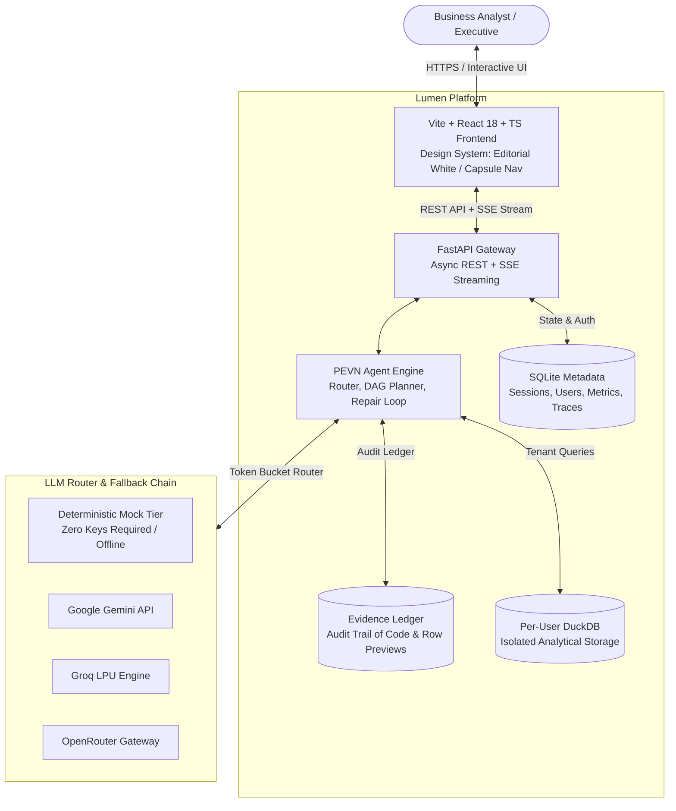
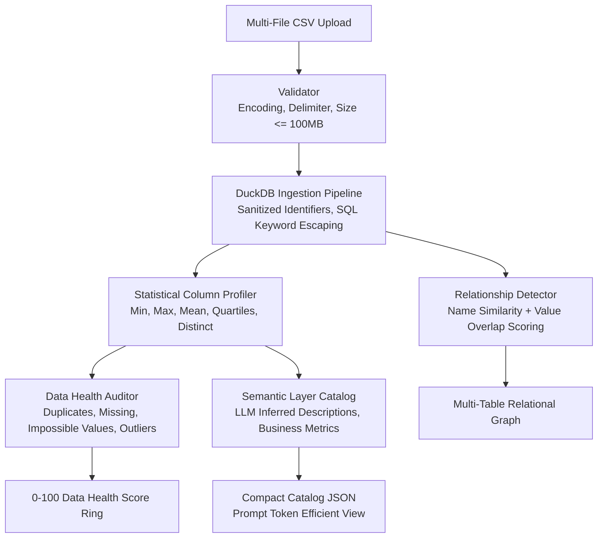
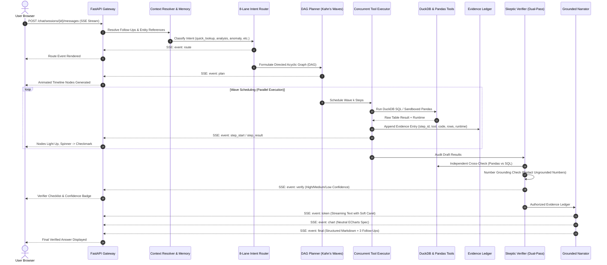
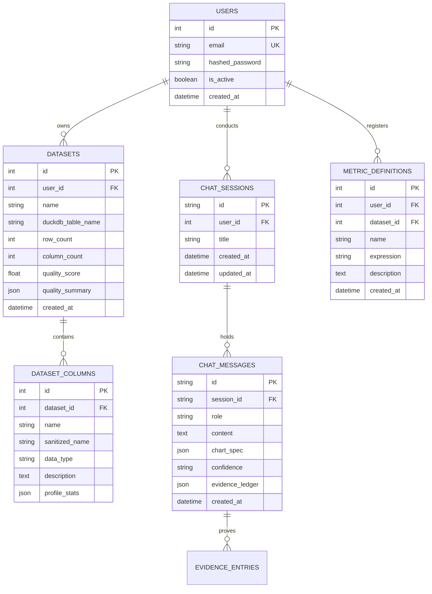

# Lumen System Architecture & Technical Specifications

> Production-grade, verified conversational business intelligence platform powered by DuckDB, evidence-grounded parallel DAG execution, and dual-pass cross-verification.

---

## 1. System Context Diagram (C4 Level 1)

---

## 2. Data Onboarding & Ingestion Pipeline (Phase A)

---

## 3. The PEVN Question Loop Sequence Diagram (Phase B)

The **Plan-Execute-Verify-Narrate (PEVN)** pipeline guarantees that every number in a user response is grounded in raw data execution.

---

## 4. Database Models & Tenant Isolation ER Diagram

---

## 5. Security Architecture & Boundary Model

1. **Analytical Data Isolation (P6)**:
   - Each authenticated user is allocated an isolated DuckDB file (`data/user_warehouses/user_{id}.duckdb`).
   - SQLite queries enforce tenant constraints via `user_id == current_user.id`.
2. **SELECT-Only SQL Validator**:
   - Every DuckDB statement is parsed with `sqlglot`.
   - Mutation commands (`DROP`, `DELETE`, `INSERT`, `UPDATE`, `ALTER`, `COPY`, `ATTACH`) raise immediate `SecurityViolationError`.
   - Automatic `LIMIT 1000` injection prevents memory exhaustion.
3. **AST-Restricted Pandas Sandbox**:
   - Python code is executed in an isolated process with restricted `__builtins__`.
   - Prohibited functions: `eval`, `exec`, `open`, `compile`, `getattr`, `__import__`.
   - Module whitelisting: only `pandas` and `numpy` functions permitted.
4. **Prompt Injection Perimeter**:
   - CSV contents are treated strictly as **DATA**, never as instructions.
   - User prompts are wrapped in an immutable structural template; system instructions cannot be overridden by cell contents.
