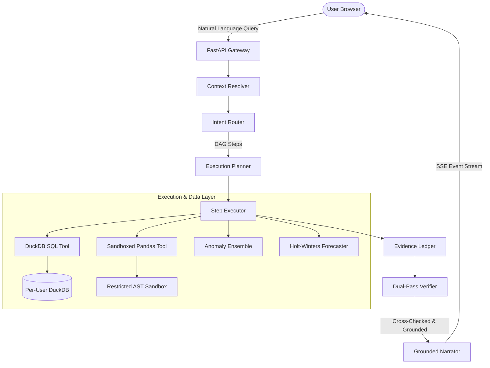

# Lumen System Architecture

## Core Tenets
1. **P1 - No LLM Computation**: The LLM writes code; DuckDB/Pandas compute.
2. **P2 - Engineered Trust**: The Verifier audits every answer before user visibility.
3. **P6 - Read-Only Analytical Isolation**: SELECT-only allowlist and tenant separation.
